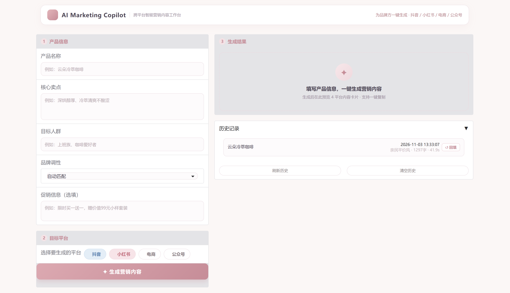
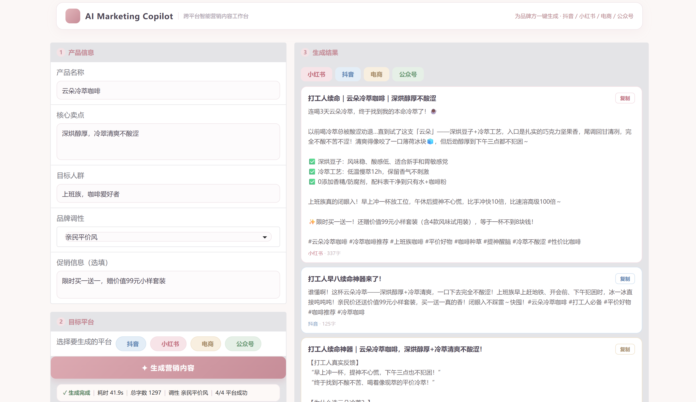

# 跨平台智能营销内容生成系统（AI Marketing Copilot）

为品牌方一键生成适配抖音、小红书、电商、公众号四个平台的结构化营销文案。输入产品名称、核心卖点、目标人群与品牌调性，系统通过「多 Agent + 双路 RAG + 结构化输出」自动产出平台风格各异、可直接发布的营销内容，并支持一键复制、历史回填。

> 解决的核心痛点：多平台营销文案依赖人工撰写，效率低、风格不统一、难以批量复制。


## 效果展示






## 核心特性

- **多 Agent 架构**：抖音 / 小红书 / 电商 / 公众号四个平台独立 Agent，平台差异收敛在各自的 System Prompt 与平台规则闭包中，Agent 共享检索器与 LLM 参数，互不通信、互不阻塞
- **双路 RAG 检索增强**：路一从爆款素材库检索相似爆款文案（「写什么」），路二从品牌调性库检索风格约束（「怎么写」），均基于 FAISS 向量索引
- **结构化输出保证**：JSON Schema 校验 + 四层兜底解析（直接解析 → 提取花括号 → 正则匹配字段 → 原文兜底），系统不会因模型输出格式问题而崩溃
- **产品化前端**：Gradio 单页工作台，卡片式布局，空状态引导、逐平台生成进度、结果元信息、一键复制、历史记录回填
- **分层 Prompt 工程**：JSON 格式约束、信息真实性约束、平台规则、负面约束、思维链引导


## 系统架构


核心流程：

1. 用户输入产品信息（名称 / 卖点 / 人群 / 调性 / 促销），选择目标平台
2. 双路 RAG 检索：路一从爆款素材库检索相似文案，路二从品牌调性库检索风格约束
3. 各平台 Agent 综合检索结果与平台规则生成文案
4. 结构化输出：JSON Schema 校验 + 四层兜底解析，前端卡片化展示


## 技术栈

| 层次 | 技术选型 |
|------|----------|
| 编程语言 | Python 3.13 |
| Agent 框架 | LangChain |
| 大语言模型 | 通义千问 qwen-plus（生成） / qwen-max（评审） |
| 向量化模型 | text-embedding-v2 |
| 向量数据库 | FAISS |
| 前端框架 | Gradio |


## 快速开始

### 1. 克隆项目

```bash
git clone https://github.com/Jiani-Shi/marketing-content-generator.git
cd marketing-content-generator
```

### 2. 创建虚拟环境

```bash
python -m venv marketing_env
source marketing_env/bin/activate
```

Windows 用户使用：`marketing_env\Scripts\activate`

### 3. 安装依赖

```bash
pip install -r requirements.txt
```

### 4. 配置 API Key

在项目根目录创建 `.env` 文件：

```
DASHSCOPE_API_KEY=sk-你的通义千问密钥
LLM_MODEL=qwen-plus
EMBEDDING_MODEL=text-embedding-v2
```

### 5. 构建向量库

```bash
python -m src.vector_store
```

### 6. 启动应用

```bash
python app.py
```

浏览器打开 http://127.0.0.1:7860 即可使用。


## 实验结果与评估

基于 **20 个产品 × 4 平台 = 80 个测试场景**，采用「A/B 对照实验 + LLM-as-Judge」双轨评估：客观工程指标（JSON 解析成功率 / 耗时 / 字数）+ 评审模型（qwen-max，temperature 0.1）对生成物四维评分（平台适配度 / 调性一致性 / 卖点表达 / 信息依据，五档量纲）。

| 指标 | 基线（A 组） | 完整系统（B 组） | 变化 |
|------|-------------|-----------------|------|
| 生成成功率 | 80/80（100%） | 80/80（100%） | — |
| 四维综合均分 | 4.23/5 | 4.34/5 | **+2.6%** |
| 平台适配度 | 3.84/5 | 4.43/5 | **+15.5%** |
| 调性一致性 | 4.52/5 | 4.41/5 | 基本持平 |
| 卖点表达 | 4.72/5 | 4.74/5 | 基本持平 |
| 信息依据 | 3.84/5 | 3.78/5 | 基本持平 |

- **证据门质量校验**：对生成结果执行「证据引用 + 原文重叠校验」，任一维度证据不足即整场景 4 维评分剔除，80 个场景中剔除 11 个（A 组 2 个、B 组 9 个），**69 个有效配对场景**进入统计
- **分平台表现**：公众号提升最显著（+0.30），小红书（+0.08）、抖音（+0.03）稳定提升，电商基本持平
- **下限抬升**：四维评分全部 ≥ 4 分的场景由 37 个增至 47 个（占有效配对的 68.1%），生成质量下限显著提高
- **耗时**：完整系统平均 9.3s/场景，基线 5.2s/场景（增强系统以约 79% 的耗时换取质量提升）


## 开发环境

普通 CPU 笔记本即可完成全部开发与演示，无需 GPU。
